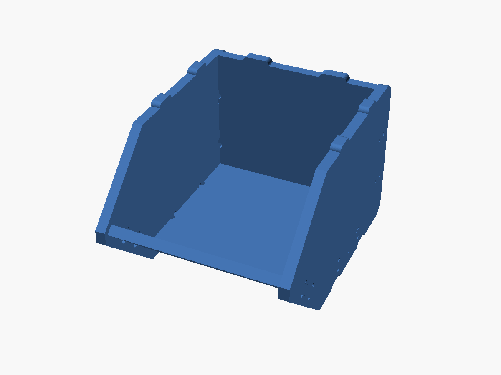
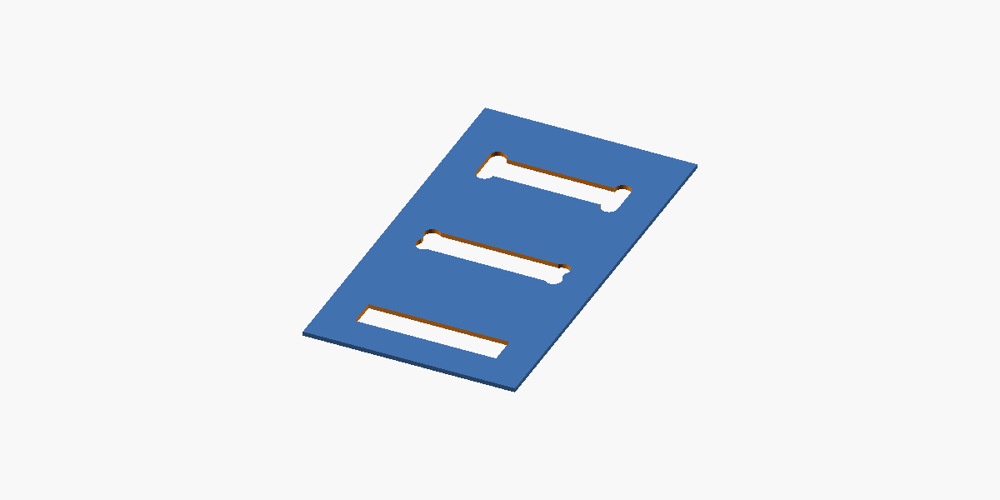

# Stackable Bin Workshop

Parametric OpenSCAD generator for CNC-cut, stackable screw/storage bins. The model was reconstructed from the original S/M/L DXF families and generalized so stock thickness, cutter diameter, relief style, and overall bin size can be changed independently.



## Features

- **Parametric bin size** — S, M, L presets or a custom `[width, depth, height]`.
- **Measured stock thickness** — set `wood_thickness` to the actual plywood/MDF thickness.
- **Cutter-driven reliefs** — every CNC relief uses `bit_diameter / 2` as its radius.
- **Relief modes** — `none`, `dogbone`, and `tbone`.
- **Independent fit clearance** — `fit_clearance` widens and lengthens female mortises without changing cutter geometry; `stack_clearance` sets the play in the stacking keys separately.
- **Flat and assembled outputs** — export a CNC layout to DXF or inspect the assembled 3D model.
- **Optional fixed top** — a tabbed top panel uses the same side mortise/tab construction as the bottom, recessed just below the stacking rim.
- **Optional hinged lid** — a separate front lid hinges just in front of the top panel, sits flush with the side walls and closes onto the front panel's top edge.
- **Dividers** — removable front-to-back and side-to-side dividers drop into floor slots and interlock where they cross.
- **Label holder** — a window in the front panel with a card channel glued behind it.
- **Hinge holes and magnetic catch** — screw pilot holes for the lid hinges, and a catch rail with magnet holes that the closed lid rests on.
- **Sheet nesting** — `output="sheets"` packs the parts of one or more bins onto stock sheets of a set size.
- **Fit checks** — `output="fit_check"` renders any overlap between parts, and `output="fit_coupon"` cuts a small test piece for dialing in clearances.

## Relief geometry



Both README images are rendered directly from `stackable_bin.scad` by OpenSCAD. No hand-drawn or substitute vector previews are used.

The relief geometry is controlled by the actual cutter diameter:

```scad
bit_diameter = 3.70;
relief_type = "tbone"; // [none,dogbone,tbone]
```

**Dogbone** relief moves the cutter center along the 45-degree bisector of the internal corner. **T-bone** relief moves the cutter center normal to the selected joint wall. Male-tab shoulder relief and female mortise relief both use the same cutter-radius logic.

## Main parameters

| Parameter | Default | Purpose |
| --- | ---: | --- |
| `preset` | `"M"` | `S`, `M`, `L`, or `custom` |
| `custom_size` | `[120,160,100]` | Outside width, depth, stack-pitch height in mm |
| `wood_thickness` | `0.25*inch` | Actual sheet thickness |
| `bit_diameter` | `3.70` | Actual CNC cutter diameter |
| `relief_type` | `"tbone"` | `none`, `dogbone`, or `tbone` |
| `fit_clearance` | `0.15` | Extra width and length applied to female slots |
| `stack_clearance` | `0.40` | Gap per side between stacking keys and the recesses they sit in |
| `include_top` | `false` | Add the fixed tabbed top panel |
| `include_lid` | `false` | Add the hinged front lid; also enables the fixed top |
| `lid_open_angle` | `0` | Lid preview angle; 0° is closed |
| `lid_side_clearance` | `0.75` | Clearance per side for the lid |
| `lid_end_clearance` | `0.0` | Gap between the closed lid and the front panel's top edge; 0 means the lid rests on it |
| `lid_hinge_gap` | `1.0` | Gap between the lid's hinge end and the top panel's front edge |
| `top_web` | `2.0` | Side-wall material left above the top panel's mortise |
| `output` | `"layout"` | `layout`, `sheets`, `assembly`, `side`, `back`, `bottom`, `front`, `top`, `lid`, `relief_test`, `fit_coupon`, or `fit_check` |

All dimensions are millimetres. The source defines `inch = 25.4` so imperial stock sizes remain readable.

### Feature parameters

| Parameter | Default | Purpose |
| --- | ---: | --- |
| `divider_cols` | `0` | Dividers running front to back, splitting the width |
| `divider_rows` | `0` | Dividers running side to side, splitting the depth |
| `divider_height` | `0` | Height above the floor; 0 means half the bin height |
| `divider_clearance` | `0.30` | Slip-fit gap in the floor slots and crossing slots |
| `include_label` | `false` | Add the label window and card channel |
| `label_size` | `[0,0]` | Card width and height; 0 sizes it to the front panel |
| `label_lip` | `3` | How far the window edge overlaps the card |
| `hinge_count` | `2` | Hinges along the lid; 0 for no holes, 1 with a long `hinge_length` for a piano hinge |
| `hinge_length` | `0` | Hinge length; 0 means up to 38 mm, as fits |
| `hinge_holes_per_leaf` | `2` | Screw holes per hinge leaf |
| `hinge_hole_offset` | `11` | Distance from the knuckle axis to the screw-hole row |
| `hinge_hole_d` | `1.6` | Pilot-hole diameter |
| `lid_catch` | `true` | Add the magnetic catch rail when the lid is on |
| `magnet_count` | `2` | Magnets across the rail |
| `magnet_d` | `6.0` | Magnet diameter |
| `lid_magnet_holes` | `true` | Magnet holes in the lid; false gives a pilot hole for a steel screw instead |
| `sheet_size` | `[600,400]` | Stock sheet width and height for `output="sheets"` |
| `sheet_margin` | `10` | Keep-out around the sheet edge |
| `sheet_gap` | `8` | Gap between parts; must exceed `bit_diameter` |
| `bin_count` | `1` | Number of complete bins to nest |
| `sheet_index` | `-1` | -1 shows every sheet; a number exports only that sheet |
| `allow_rotate` | `true` | Let parts turn 90° to fit (turn off to keep the grain direction) |

## Presets

| Preset | Nominal size (W × D × H) |
| --- | --- |
| S | 90 × 120 × 80 mm |
| M | 120 × 160 × 100 mm |
| L | 150 × 200 × 120 mm |

The dimensions describe nominal outside width/depth and stacking pitch height. Joinery and stacking keys are regenerated from the chosen stock thickness rather than uniformly scaling a DXF.

## Usage

Open `stackable_bin.scad` in OpenSCAD, edit the parameters at the top, and choose an output mode.

For a flat CNC layout:

```bash
openscad -o bin-layout.dxf \
  -D 'output="layout"' \
  -D 'preset="M"' \
  -D 'wood_thickness=6.35' \
  -D 'bit_diameter=3.175' \
  -D 'relief_type="tbone"' \
  stackable_bin.scad
```

For an assembly STL:

```bash
openscad -o bin-assembly.stl \
  -D 'output="assembly"' \
  -D 'preset="M"' \
  stackable_bin.scad
```

For a closed bin with a fixed top and hinged front lid:

```bash
openscad -o closed-bin.stl \
  -D 'output="assembly"' \
  -D 'include_top=true' \
  -D 'include_lid=true' \
  -D 'lid_open_angle=55' \
  stackable_bin.scad
```

The lid is designed for a surface-mounted hinge (for example a small piano or butt hinge) on the outside of the bin. The pivot axis is the lid's outer edge at its hinge end, level with the top panel's upper face; one leaf goes on the top panel and the other on the lid, bridging the small gap between them. Closed, the lid rests on the top end face of the sloped front panel, which acts as its stop. Screw-hole placement is left to the hardware.

With another bin stacked on top, the lid can only open part way before it hits the upper bin. OpenSCAD echoes this limit as `stacked_lid_limit` (about 107° for the M preset) and prints a note when `lid_open_angle` is past it.

## Dividers

`divider_cols` and `divider_rows` add removable dividers. Each one has tabs that drop into loose slots in the floor, and where a front-to-back divider crosses a side-to-side one, half-depth slots let them interlock. Nothing is glued, so they lift out to rearrange. Each divider part in the layout is one copy, so a layout with `divider_cols=2` has two identical front-to-back dividers. If you ask for more dividers than the floor can hold, OpenSCAD stops with a message.

## Label holder

With `include_label=true`, the front panel gets a window. Behind it, glue a U-shaped spacer and then a backer onto the panel's inner face. That makes a channel open toward the top of the panel. Drop a card in from inside the bin and it shows through the window. With the defaults the card is about 79 × 30 mm on the M preset; set `label_size` to match your cards.

## Hinge holes and magnetic catch

With a lid, the top panel and the lid get pilot holes for two butt hinges, `hinge_hole_offset` from the knuckle axis. Measure your hinge and set `hinge_length`, `hinge_holes_per_leaf` and `hinge_hole_offset` to match. Holes smaller than the cutter (1.6 mm by default) can't be routed with it, so treat them as drill points.

`lid_catch` adds a rail between the side walls, just behind the front panel's top edge. The closed lid rests on the rail and the front panel. The rail and the lid each get `magnet_count` holes sized for press-fit `magnet_d` magnets, lined up so the magnets meet when the lid closes. Mind the polarity when you glue them in.

## Sheet nesting

`output="sheets"` packs every part of `bin_count` bins onto sheets of `sheet_size`, tallest parts first, in rows. It echoes `sheet_count`. With `sheet_index=-1` it shows all sheets side by side (sheet outlines appear in preview only). To export one sheet at a time, set `sheet_index`:

```bash
for i in 0 1 2; do
  openscad -o bins-sheet-$i.dxf \
    -D 'output="sheets"' -D 'bin_count=4' -D "sheet_index=$i" \
    -D 'sheet_size=[600,400]' stackable_bin.scad
done
```

`sheet_gap` must be larger than the cutter so it can pass between parts. Set `allow_rotate=false` if the grain direction matters.

For a custom 150 × 220 × 120 mm bin:

```bash
openscad -o custom-bin.dxf \
  -D 'preset="custom"' \
  -D 'custom_size=[150,220,120]' \
  -D 'output="layout"' \
  stackable_bin.scad
```

## CNC notes

Measure the actual sheet with calipers and use that value for `wood_thickness`. Set `bit_diameter` to the measured or known cutter diameter. Tune `fit_clearance` separately for your machine, material, and preferred press/slip fit.

Before cutting a full sheet, `output="relief_test"` provides a compact comparison of the unrelieved, dogbone, and T-bone slot geometry.

`output="fit_coupon"` is a small test cut for choosing clearances. It has a plate with four mortises (`fit_coupon_steps`, 0 to 0.3 mm by default), a tab piece to try in each, and a key strip with a recess strip at four stacking clearances (`stack_coupon_steps`, 0.2 to 0.5 mm). Each slot or recess is marked with one to four small holes in the order of its step list. Use the best-fitting values for `fit_clearance` and `stack_clearance`.

## Fit check

`output="fit_check"` renders the intersection of every pair of parts in the assembly, so an empty render means nothing overlaps. Set `fit_stacked=true` to check the bin against a second, closed bin stacked on top instead.

`tools/fit_check.py` runs those checks for the S, M and L presets at several lid angles (including the stacked limit), plus a build with the catch rail, label holder and dividers, and exits non-zero if any parts overlap:

```bash
python3 tools/fit_check.py
```

## Render automation

[GitHub Actions](.github/workflows/render-openscad.yml) regenerates the PNG previews with OpenSCAD whenever the model or render workflow changes, then commits the updated renders under `docs/`. A [separate workflow](.github/workflows/fit-check.yml) runs `tools/fit_check.py` on pushes and pull requests.

## Source

The current generator is in [`stackable_bin.scad`](stackable_bin.scad).
